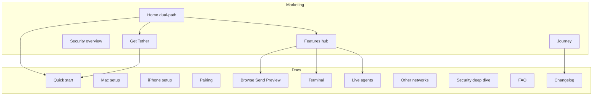

# Tether — Web Design Guidelines (v1)

> Canonical guidelines for the product marketing site and docs. Companion to [`DESIGN.md`](DESIGN.md) (apps) and [`PRD.md`](PRD.md) (behavior). When this file and implementation disagree, this file wins for web visuals, IA, voice, and motion. `PRD.md` still wins for product claims and scope; `DESIGN.md` still wins for in-app UI.

**Placement:** Site code lives at `website/` at the Tether repo root (separate from Swift apps). Host wherever is convenient later (Cloudflare Pages / GitHub Pages / Vercel).

---

## Locked decisions

| Decision | Value |
|---|---|
| Audience | Dual-path from the hero — **Casual** and **Power** get equal weight (not a single primary persona) |
| Scope (v1) | Marketing site + full docs (setup, pairing, features, security, remote, journey/changelog) in one place |
| Stack | Astro (static + MDX content collections) with progressive enhancement; **no SPA** for marketing |
| Honesty (from PRD) | Never claim category novelty. Differentiate on zero-config, two modes, scoped shares, QuickLook, local-first |
| Light/dark | Light-first site; **one** intentional dark chapter (Terminal / Agents) |

### Out of scope (guidelines / v1 site)

App Store assets, analytics, blog CMS, i18n, Windows/Android messaging as product promises.

---

## 1. Brand extension (app → web)

Reuse app personality from [`DESIGN.md`](DESIGN.md): **quiet, capable, a little geeky.** Short plain sentences. No jargon on marketing surfaces (`TCP`, `Bonjour`, `port` stay in docs / Terminal chapters).

### 1.1 Color tokens

| Token | Value | Web use |
|---|---|---|
| Accent gold | `#C98A1B` / `#E8B04A` | Primary CTA fill, progress metaphors, selection underline |
| Accent text | `#7A5200` / `#F2C970` | Links / accent words on light / dark |
| Success / warning / danger | App tokens from `DESIGN.md` §3.1 | Status chips in **docs only** |
| Marketing surface | `#F5F5F7` → white | Light-first pages (Apple-adjacent) |
| Terminal chapter | `#121417` / `#E6E1D6` / prompt `#E8B04A` | One dark “Power” chapter only |

App token reference (do not invent web-only status colors):

| Token | Light | Dark |
|---|---|---|
| `success` | `#1F8A4C` | `#4CC38A` |
| `warning` | `#B26A00` | `#F0A84A` |
| `danger` | `#C62F2F` | `#FF6B6B` |

Rules:

- One accent (gold). Hierarchy from type + space, not cards or glow.
- Never use fill gold (`#C98A1B`) as small text on light backgrounds — use `accentText` (`#7A5200`).
- Glass / blur only on sticky nav chrome.
- Prefer CSS variables mirroring the names above.

### 1.2 Typography

| Surface | Stack | Notes |
|---|---|---|
| Marketing | SF Pro system stack + optional display for brand wordmark | Headlines large; body readable |
| Docs | Same system stack; SF Mono / `ui-monospace` for code | Utility surface |

Suggested system stacks:

```css
--font-sans: -apple-system, BlinkMacSystemFont, "SF Pro Text", "SF Pro Display",
  "Helvetica Neue", Helvetica, Arial, sans-serif;
--font-mono: "SF Mono", ui-monospace, Menlo, Monaco, Consolas, monospace;
```

### 1.3 Case and chrome

- Sentence case in UI chrome (nav, buttons, docs labels) — matches the app.
- Marketing headlines may use short Title Case sparingly (Apple-adjacent).
- Body voice matches the app: short, plain, benefit-led.

### 1.4 Do not ship

- Purple gradients
- Cream + serif + terracotta
- Newspaper / broadsheet layouts
- Pill-stat strips
- Floating badge clutter on hero media
- Abstract blobs as the hero (use real device frames + real screenshots)

---

## 2. Information architecture



### 2.1 Chrome

**Primary nav:** Product · Features · Docs · Security · Journey · GitHub

**Footer:** Quick start, Mac / iPhone, Pairing, Remote, Security, Changelog, Privacy (local-only statement), License / repo link

### 2.2 Routes (v1)

| Route | Role |
|---|---|
| `/` | Dual-path homepage |
| `/features` | Features hub |
| `/security` | Security overview (marketing depth) |
| `/journey` | Product story / milestones |
| `/download` | Get Tether (placeholders until distribution is ready) |
| `/docs/*` | Full docs (see §6) |

---

## 3. Homepage narrative (dual-path)

### 3.1 Hero (viewport 1 — one composition)

Budget: brand, one headline, one supporting sentence, one CTA group, one dominant dual-device visual. Nothing else in the first viewport.

| Element | Locked copy |
|---|---|
| Brand | **Tether** (hero-level signal — larger / heavier than the headline) |
| Headline | Your Mac. On your iPhone. |
| Support | Browse, send, and preview files — or open a real terminal — with no cloud and no passwords to type. |
| CTA pair (equal weight) | **For everyday use** → `#casual` · **For power users** → `#power` |
| Secondary | Read the docs (quiet text link) |

**Visual:** Real iPhone + Mac frames with product screenshots; soft shadow on `#F5F5F7`. No inset media cards, no floating promo chips on the hero image.

### 3.2 Pitch alternatives (reuse elsewhere — not all in hero)

| Use | Copy |
|---|---|
| Tagline (PRD) | Open your Mac’s files from your iPhone in two taps. No setup, no cloud. |
| Dual | Two ways in. One local connection. |
| Trust | Only the folders you share. Nothing leaves your Wi‑Fi. |

### 3.3 Section order after hero

1. **Problem strip** (one idea) — AirDrop can’t browse; iCloud needs the cloud; SMB/SSH need IPs and credentials. Tether: discover → QR → done.
2. **Path A — Casual** (light) — Browse · QuickLook · Send / Inbox / Shelf · transfers. Sticky scroll scene: phone UI steps through “tap Mac → open PDF → send photo.”
3. **Path B — Power** (theme morph to dark) — Virtual terminal · fetch / htop · live coding agents · Dynamic Island “Needs you.” Sticky scene: terminal prompt + agent status.
4. **Setup in under a minute** (shared) — four steps: Install Mac → Share folder → Scan QR → Browse. Numbered, calm, no disco.
5. **Trust** (light) — Encrypted channel, Keychain keys, scoped shares, approve / revoke, no account. Link to Security docs.
6. **Bento once** (proof grid) — Local only · QR pair · GUI + Terminal · QuickLook · Inbox / Shelf · Agents (honest: allowlisted CLIs).
7. **Journey teaser** → full Journey page.
8. **Get Tether** → build-from-source / TestFlight placeholder until App Store exists; link Quick start.

### 3.4 Cards and composition

- Default: no cards. Never use cards in the hero.
- Cards only when they are the container for a user interaction (e.g. docs search field). If removing a border, shadow, background, or radius does not hurt understanding, it should not be a card.
- Bento is a **proof grid once** — not a repeating pattern across every section.

---

## 4. Motion language

**Surface budget:** Marketing = cinematic but restrained. Docs = near-invisible utility motion.

| Motion | Where | Spec |
|---|---|---|
| Sticky translucent nav | Global | ~48px, backdrop blur; chapter-adaptive (light ↔ dark) |
| Damped scroll-progress | Hero product + Casual / Power sticky scenes | Lerp toward scroll; never scroll-jack |
| Theme morph | Entering / leaving Power chapter | Light ↔ charcoal; discrete snap via `IntersectionObserver` by default |
| Ambient float | Device frames when idle | Slow, subtle; off under Reduce Motion |
| Step wipe / text reveal | Setup 4-step | One idea at a time on scroll |
| Cross-fade screenshots | Feature swaps | 150–250 ms (match app thumbnail fade) |
| Pairing metaphor | Setup section | Soft pulse on QR / reticle; success checkmark scale ~0.35 s |

### 4.1 Must ship (marketing)

1. Continuous scroll-progress on one sticky product scene
2. Light ↔ dark theme morph into Power
3. Ambient float on hero devices

### 4.2 Reduce Motion

Replace transforms with opacity cross-fades; disable float / pulse / scrub; keep content fully readable without animation. Honor `prefers-reduced-motion`, `prefers-reduced-transparency`, and `prefers-contrast`.

---

## 5. Voice and microcopy bank

**Voice:** Benefit-led, concrete, never blame the user. Exclamation marks only for pairing success in the **app** — avoid them on the marketing site entirely.

| Surface | Example |
|---|---|
| Casual path H2 | Browse your Mac like it’s in your pocket |
| Casual body | Open a PDF. Preview a video. Send photos into an Inbox you can drag out on the Mac. |
| Power path H2 | A terminal that knows its place |
| Power body | Everyday commands stay inside shared folders. Allowlisted agents run live on the Mac — your phone is the screen and keyboard. |
| Setup H2 | Pair once. Open again in two taps. |
| Trust H2 | Local by design |
| Trust body | No account. No cloud sync. Encrypted with the key from pairing. You choose the folders; you can revoke a phone anytime. |
| Error-adjacent (docs) | Couldn’t find your Mac. Keep both devices on the same Wi‑Fi, then look again. |

### 5.1 Avoid

- “Revolutionary,” “magic,” “disrupts AirDrop,” fake novelty
- IP / port dumps on marketing pages (those belong in docs / remote / terminal)
- Claiming Tether invents local file access for iPhone

### 5.2 Honesty differentiators (from PRD §2.2)

Lead with these — not category novelty:

1. Zero-config (discovery + one-time QR)
2. One app, two modes (GUI + terminal)
3. Scoped shares (only folders you pick)
4. Native QuickLook
5. Local-first (no account / no cloud sync for the core path)

---

## 6. Full docs structure (v1)

Source content primarily from [`README.md`](../README.md), [`PRD.md`](PRD.md), and [`help/remote-access.md`](help/remote-access.md). Docs are utility: dense, searchable, left nav + TOC.

| Doc page | Purpose |
|---|---|
| `/docs` | Index + “Start here” |
| `/docs/quick-start` | Mac + iPhone + pair in one page |
| `/docs/mac` | Host install, shares, Inbox, Shelf, Settings map |
| `/docs/iphone` | Client install, signing note, tabs, appearance |
| `/docs/pairing` | QR / code, approval, revoke, Local Network primer |
| `/docs/files` | Browse, search, sort, QuickLook, downloads / uploads |
| `/docs/send` | Send tab, Share Extension, Inbox, Shelf |
| `/docs/terminal` | Command table, limits (no general shell) |
| `/docs/agents` | Allowlist, PTY, Live Activity / Island, trust warning |
| `/docs/monitor` | htop / fetch surfaces |
| `/docs/remote` | Tailscale / relay / port forward (from `help/remote-access.md`) |
| `/docs/lid-closed` | Lid-closed awake + Tailscale reliability / battery (from `help/lid-closed-tailscale.md`) |
| `/docs/security` | CryptoKit summary (high-level), scoped paths, Keychain, revoke — **no secret material** |
| `/docs/faq` | Guest Wi‑Fi, hotspot, transfers need foreground, etc. |
| `/docs/changelog` | Versioned What’s new (seed from app What’s new + README changelog; current product version **3.3**) |

### 6.1 Docs chrome

- Quiet sidebar; gold accent for current item
- Monospace for commands / codes only
- Searchable (Astro Pagefind or similar) without shipping a heavy SPA
- Status chips may use success / warning / danger tokens; marketing pages should not

### 6.2 Docs motion

Near-invisible: focus rings, subtle sidebar highlight, optional short cross-fade on in-page TOC jump. No sticky cinematic scenes.

---

## 7. Journey page

Tell the product story as milestones, not mythology. Align to PRD releases + README version **3.3**.

| Chapter | Story |
|---|---|
| Meetup slice (M0) | Discover, QR, encrypted browse / download, menu-bar host |
| Polished files (M1) | Grid / list, uploads, transfers |
| Terminal (M2) | Virtual shell inside shares |
| Ship-shape (M3) | Devices, revoke, settings, demo polish |
| Send (3.0) | Inbox + Shelf + Share Extension |
| Agents & Island (2.x–3.x) | Live PTYs, Live Activities, monitor |
| Reach further | Other networks / relay |
| Now (3.3) | Lid-closed Tailscale, battery control, Neutral polish — plus what’s still out of scope (Windows / Android, no full-disk browse) |

Tone: engineering diary, short paragraphs, dated if possible. Link each chapter to the relevant docs page.

---

## 8. Visual asset checklist

Capture before build polish. Use **synthetic demo folders** — never show real user file contents.

- [ ] Mac window: Status + Shared folders
- [ ] Pairing QR window
- [ ] iPhone: Hosts, Files list / grid, Preview, Send, Terminal (light GUI + dark term), Transfers
- [ ] Dynamic Island / Live Activity composites (marketing only; **no scraped PTY text** — fixed status wording only, per app rules)
- [ ] Device frames (iPhone + Mac) with soft shadow on `#F5F5F7`
- [ ] Optional short silent loop of pairing success (or static end-frame under Reduce Motion)

Lab screenshots in the product repo (e.g. `.lab-shots/`) may seed these; re-export for web (WebP / AVIF) before shipping.

---

## 9. Accessibility and performance

- WCAG 2.2 AA contrast; gold text uses `accentText` on light backgrounds
- `prefers-reduced-motion` / `prefers-reduced-transparency` / `prefers-contrast`
- Focus-visible rings; semantic headings; skip link
- Hero LCP: optimized WebP / AVIF stills first; video / scrub lazy
- Docs searchable without a heavy SPA
- Keyboard-reachable primary nav and docs sidebar

---

## 10. Implementation deliverables

When executing the site build:

1. Keep this file as the source of truth; update it when IA or locked copy changes.
2. Scaffold `website/` (Astro + MDX collections: `docs`, `changelog`).
3. Build homepage dual-path + setup + trust sections with the motion inventory in §4.
4. Port README / help into docs routes; add Journey + Security.
5. Wire nav / footer; placeholder Download until distribution is ready.
6. Manual QA: mobile / desktop, Reduce Motion, contrast, docs search.

### 10.1 Suggested `website/` shape

```
website/
  astro.config.*
  package.json
  public/
    images/          # frames, screenshots, favicons
  src/
    components/      # Nav, Footer, DeviceFrame, sticky scenes
    layouts/
    pages/
      index.astro
      features.astro
      security.astro
      journey.astro
      download.astro
      docs/
    content/
      docs/          # MDX collection
      changelog/
    styles/
      tokens.css     # gold, surfaces, terminal chapter
```

---

## 11. Cross-references

| Topic | Source of truth |
|---|---|
| App look, tokens, in-app copy | [`DESIGN.md`](DESIGN.md) |
| Behavior, scope, honesty, milestones | [`PRD.md`](PRD.md) |
| Install, commands, agents, changelog seed | [`../README.md`](../README.md) |
| Other networks / Tailscale / relay | [`help/remote-access.md`](help/remote-access.md) |
| This site | **This file** |

---

*End of Web Design Guidelines v1*
